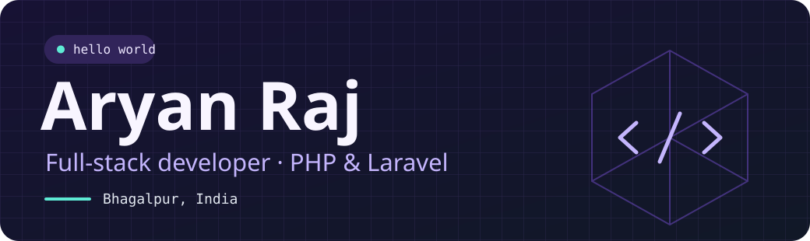

<p align="center">
  
</p>


## Hey, I’m Aryan 👋

I build web applications, REST APIs, and admin dashboards with **PHP and Laravel**. I like working across the stack, from the query behind a dashboard to the screen someone uses every day.

[**Say hello on Telegram ↗**](https://t.me/Coderaryan)

## The workbench

| ⚙️ Backend | 🎨 Frontend | 📱 Mobile |
| :--- | :--- | :--- |
| `PHP` · `Laravel` | `JavaScript` · `React` · `Next.js` | `Dart` · `Flutter` |
| API design and database queries | Responsive interfaces with Tailwind CSS | Mobile app interfaces |

### 🔍 Two questions on my desk

- **Laravel queues** · What work can move off the request path?
- **Database performance** · Which query is doing more work than it needs to?

<details>
<summary><strong>☕ Open the debugging console</strong></summary>

```text
$ reproduce
$ read-the-logs
$ fix
$ verify

One more coffee if it only fails in production.
```

</details>
